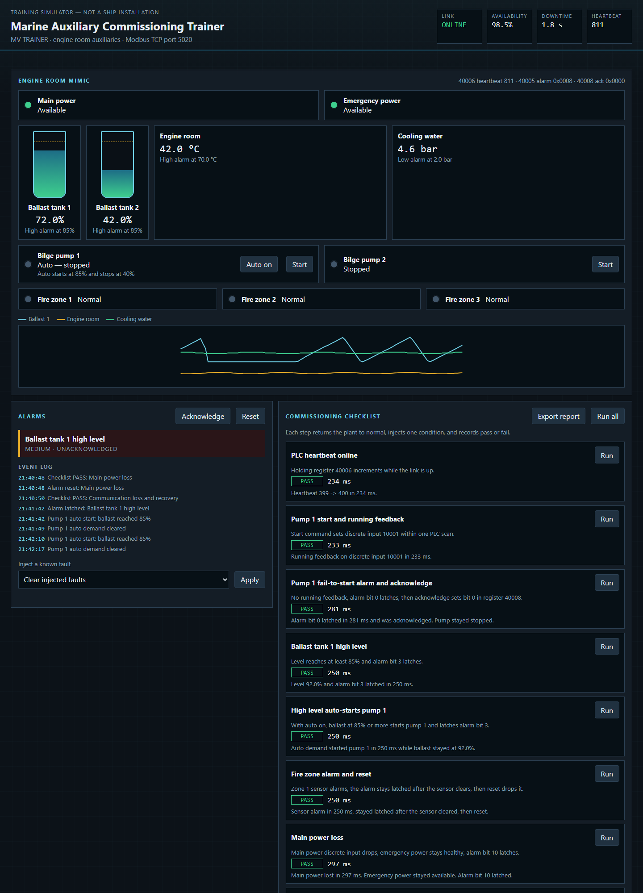

# Marine Auxiliary Commissioning Trainer

Personal project: a laptop trainer for the commissioning loop used on a PLC/SCADA alarm system. It is a simplified engine-room model, not a ship installation and not a substitute for sea-going experience.

The PLC side is a Modbus TCP simulator. The SCADA page never reads the simulator's Python objects. It polls the register map, raises alarms from those values, and writes commands and fault coils back onto that same map.

## What is on the screen

- Bilge pumps, ballast tanks, engine-room temperature, cooling-water pressure, three fire zones, main power, and emergency power.
- Pump 1 auto: the tank fills, the pump starts at 85%, and it stops at 40%. A trend shows level, temperature, and pressure.
- Latched alarms with acknowledge, reset, and an event log.
- An eight-step functional checklist. Each step injects one known condition and records pass or fail, plus the time until the expected result. Export report downloads that sheet.
- Availability and downtime from a heartbeat watchdog. If holding register 40006 stops changing for 1.5 s, the link is counted down.

The register map is in [plc/modbus_map.md](plc/modbus_map.md). The same checks are written out in [docs/commissioning-checklist.md](docs/commissioning-checklist.md). Resume wording is in [docs/resume-bullets.md](docs/resume-bullets.md).



## Run on the laptop

From this folder, in two terminals:

```text
python -m venv .venv
.venv\Scripts\activate
pip install -r requirements.txt
python -m plc.server
```

```text
.venv\Scripts\activate
python -m uvicorn api.main:app --host 127.0.0.1 --port 8000
```

Open http://127.0.0.1:8000 . Interactive API docs are at http://127.0.0.1:8000/docs .

The PLC listens on port 5020 so it does not need administrator rights for port 502. Override the SCADA target with `PLC_HOST` and `PLC_PORT` if the simulator is not on `127.0.0.1`.

## Run with Docker

Both services are Linux containers on one Compose network. The SCADA container reaches the PLC by the hostname `plc`.

```text
docker compose up --build
```

Then open http://127.0.0.1:8000 .

## How to describe it

This is a personal trainer for practising PLC/SCADA commissioning: a documented Modbus map, latched alarms, and a checklist that proves one fault at a time. It is not time spent commissioning a vessel.
